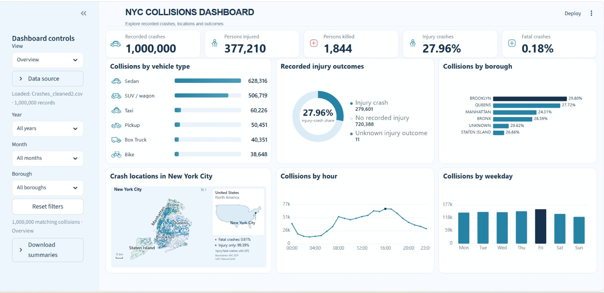
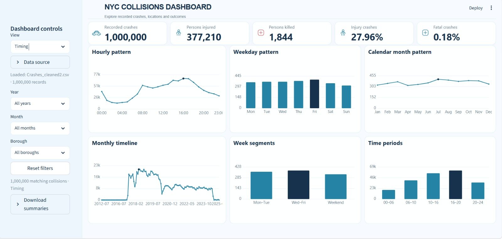
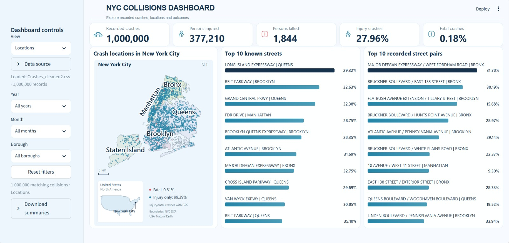
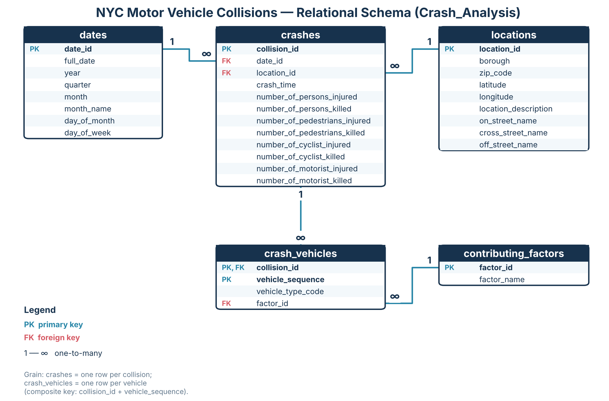
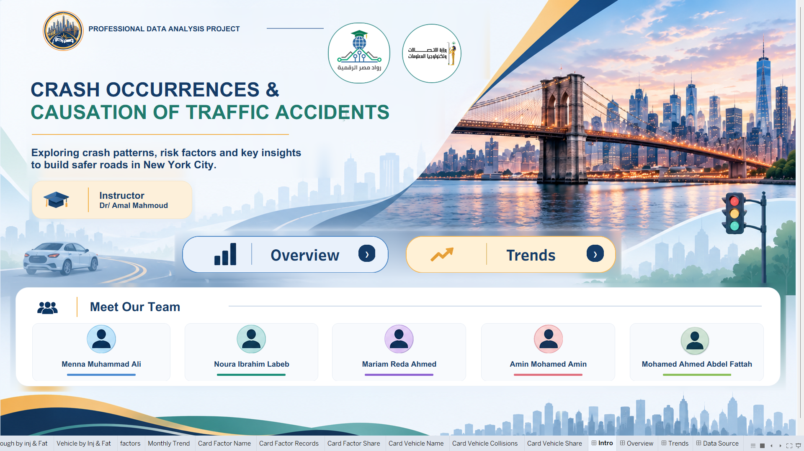
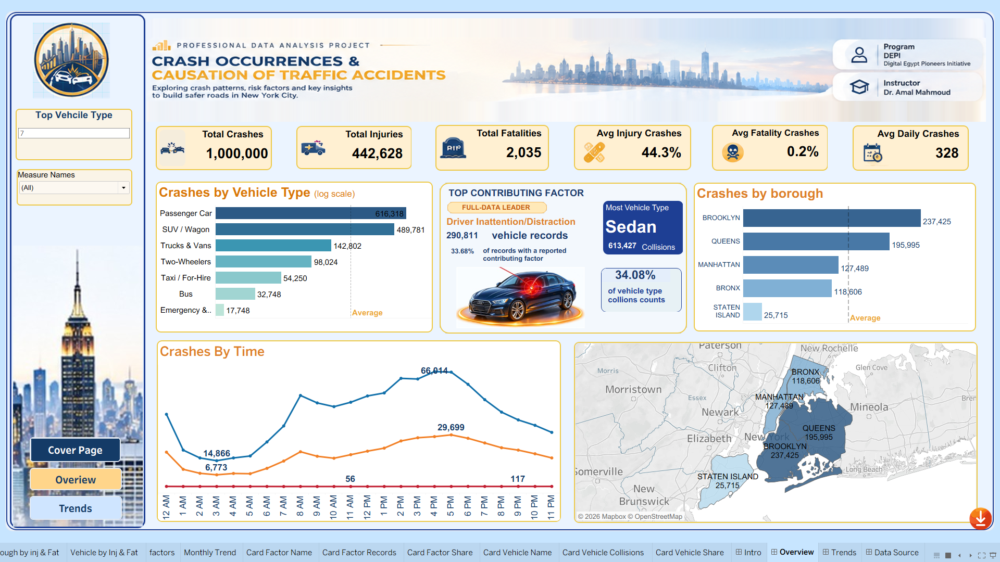
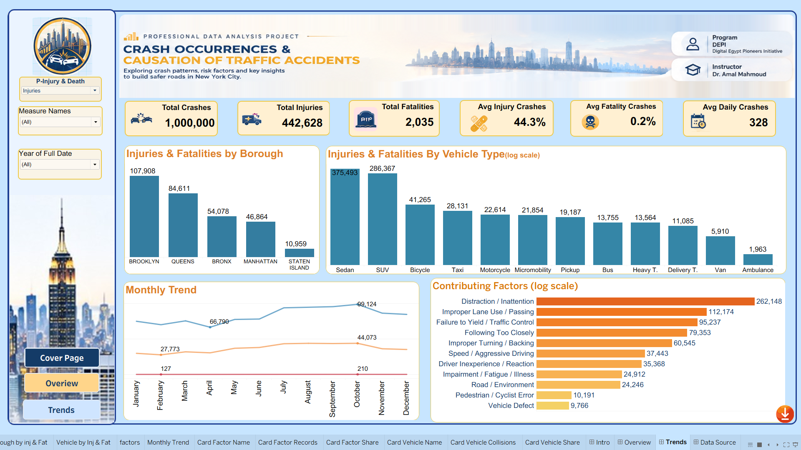

<div align="center">

# 🚦 Crash Occurrences & Causation of Traffic Accidents

### NYC Motor Vehicle Collisions · Professional Data Analytics Case Study

**DEPI | Digital Egypt Pioneers Initiative · Data Analysts Track**

**Instructor:** Amal Mahmoud

Noura Ibrahim Labeb • Menna Muhammad Ali • Mariem Reda Ahmed • Amin Mohamed Amin • Mohamed Ahmed Abdel Fattah

</div>

---

## Contents

1. [Overview](#overview)
2. [Dataset](#dataset)
3. [Python](#python) · [SQL](#sql) · [Tableau](#tableau) · [Power BI](#power-bi)
4. [Cross-Track Comparison](#cross-track-comparison)
5. [Repository Structure](#repository-structure)
6. [Project Documentation](#project-documentation) *(full methodology, sections 1–16)*

---

## Overview

This project analyzes **1,000,000 police-reported motor vehicle collisions in New York City** to understand when, where, and how collisions happen and who gets hurt.

The work is split into **four independent tracks**. Each team member took the *same* raw data through the *full* lifecycle — cleaning → analysis → visualization → insights — in a different tool, so the results can be cross-checked.

| Track | Tool | Status |
|---|---|---|
| [Python](#python) | Pandas · GeoPandas · SciPy · Statsmodels | ✅ Complete |
| [SQL](#sql) | SQL Server (T-SQL) | ✅ Complete |
| [Tableau](#tableau) | Tableau, multi-page dashboard | ✅ Complete |
| [Power BI](#power-bi) | Power BI | 🚧 In progress |

> The analysis finds patterns and associations. It does **not** prove legal responsibility or causation.

---

## Dataset

| | |
|---|---|
| **Source** | [NYC Open Data — Motor Vehicle Collisions: Crashes](https://data.cityofnewyork.us/Public-Safety/Motor-Vehicle-Collisions-Crashes/h9gi-nx95) (provider: NYPD) |
| **Size** | 1,000,000 collisions × 29 columns; 1,799,870 vehicle records |
| **Period** | 2018-07-04 → 2026-11-06 (2026 is a partial year) |
| **Grain** | One row = one collision |
| **Quality** | All collision IDs unique; no fully duplicated rows |

**Fields:** crash date/time, borough, ZIP, coordinates, street names, persons injured/killed (total, pedestrians, cyclists, motorists), contributing factors (vehicles 1–5), vehicle types (vehicles 1–5).

> Data is preliminary and subject to amendment by the NYPD, and covers police-reported collisions only.

---

## Python

📁 `Python/NYC Analysis 2018-2026.ipynb` · Pandas, GeoPandas, SciPy, Statsmodels, Matplotlib

### Cleaning
| Step | Result |
|---|---|
| Types | Dates/times converted (0 invalid); ZIP stored as string |
| Text | Borough, street, factor and vehicle columns standardized |
| Borough | 294,770 missing → **239,283 recovered** by spatial join; 55,487 left `UNKNOWN` |
| ZIP | 320,225 missing → **262,496 recovered**; 57,729 left missing |
| Coordinates | Out-of-range values nulled; 75,643 records have none |
| Other missing values | Vehicle, factor and street gaps **kept, not imputed** |

**New features:** `Crash Severity` (Low / Medium / High / Unknown), `Time Period`, `Total Casualties`, `Day Type`.
**Severity:** Low 669,299 · Medium 328,582 · High 2,108 · Unknown 11.

### Analysis
Descriptive statistics → 10 exploratory questions (severity, hour, weekday, month, factor, vehicle type, road user) → Spearman correlation → Chi-Square tests with Cramér's V.

### Key insights
- **66.9%** of collisions have no injuries or deaths; ≈0.2% are fatal.
- Volume peaks at **4–5 PM**, but the **fatal-crash rate peaks at 4 AM** (0.656%) — frequency and severity differ.
- **Bicycles** (82.8%) and **motorcycles** (66.2%) have the highest injury-crash share; motorcycles also have the highest fatal share (1.96%).
- **Motorists** suffer the most injuries (310,399); **pedestrians** the most deaths (1,002 vs 897 motorists, 169 cyclists).
- *Lost Consciousness* and *Illness* have the highest fatal rates, but on small samples; *Unsafe Speed* has the most fatal crashes (346).
- Statistically significant tests have **tiny effect sizes** (borough vs injury V ≈ 0.03; weekday vs injury V ≈ 0.005). Daily volume vs injury share: ρ = −0.55.

### Streamlit Dashboard





---

## SQL

📁 `sql/NYC_Motor_Vehicle_Collisions_SQL_Final_Original_Plus_Missing_Values.sql` · SQL Server 2025 Express, database `Crash_Analysis`

The raw table `dbo.nyc_crashes_1m` is **never modified**; all cleaning lives in a view.

### Script structure
| Sections | Purpose |
|---|---|
| 1–4 | Row count, ID uniqueness, missing-value profile, ID validity (32-hex → GUID) |
| 5–7 | Data types, date/time preview, date range and invalid dates |
| 8, 13 | Top contributing factors and vehicle types across all five slots |
| 9–12 | Crashes by borough, hour, weekday; injuries/fatalities by borough |
| 14 | Negative or non-convertible casualty values |
| 15 | **`dbo.vw_nyc_crashes_clean`** — cleaned view for BI tools |

### Cleaning rules (in the view)
| Field | Treatment |
|---|---|
| Borough | blank → `UNKNOWN / UNASSIGNED` |
| Contributing factors (×5) | blank / Unknown / Unspecified / Does Not Apply / N/A → `NULL` |
| Vehicle types (×5) | blank → `UNKNOWN VEHICLE TYPE` |
| Injuries / fatalities | missing stays `NULL`, never 0 |
| Date / time / coordinates | `TRY_CONVERT`; invalid → `NULL` |

### Relational model
`crashes` · `dates` · `locations` · `crash_vehicles` (key: `collision_id` + `vehicle_sequence`) · `contributing_factors`.
**Grain rule:** count `DISTINCT collision_id` for collision KPIs; never sum collision-level measures after joining to vehicle rows.



**Run:** create `Crash_Analysis` → import CSV as `dbo.nyc_crashes_1m` → run Sections 1–14 → run Section 15.

---

## Tableau

📁 `tableau/NYC_Crashes.twbx` (~73 MB: used GitHub Release)
📥 [Download the Tableau workbook](https://github.com/mohoka2006-a11y/Crash_Occurances_causation_Analysis/releases/tag/V1.0)

### Data model
Five tables connected with Tableau *relationships* (each measure keeps its own grain):

| Table | Rows | Key |
|---|---:|---|
| `Crash_Fact` | 1,000,000 | `collision_id` |
| `Crash_Vehicles_dim` | 1,799,870 | `collision_id` + `vehicle_sequence` |
| `Contributing_Factors_dim` | 62 | `factor_id` |
| `Dates_dim` | 3,048 | `date_id` |
| `Locations_dim without unkown` | 301,405 | `location_id` |

### Dashboard
| Page | Content |
|---|---|
| Intro | Banner, team, navigation |
| Overview | 6 KPI cards, borough chart, map, hourly chart, Top-N vehicle types, top factor/vehicle cards |
| Trends | Monthly trend with moving average, injuries/deaths by borough and vehicle type, factors, year filter |
| Data Source | Model documentation |

**Controls:** Top-N vehicle types (default 7) · metric selector (Crashes / Injuries / Deaths) · Injuries-vs-Deaths toggle · year filter.

### KPIs
| Total crashes | Persons injured | Persons killed | Avg daily crashes |
|---:|---:|---:|---:|
| **1,000,000** | **442,628** | **2,035** | **328.1** |

### Key insights
- **Hour:** peak at **4 PM (66,014)** and **5 PM (65,680)**.
- **Weekday:** **Friday** busiest (157,847), **Sunday** lowest (125,779).
- **Month:** **October** leads: 99,124 crashes, 44,073 injuries, 210 deaths.
- **Borough:** Brooklyn 237,425 · Queens 195,995 · Manhattan 127,489 · Bronx 118,606 · Staten Island 25,715.
- **Top factor:** *Driver Inattention/Distraction*, 290,811 **vehicle-level records** (not collisions).
- **Top vehicles:** Sedan 588,461 · SUV/Station Wagon 489,468 · Taxi 52,259 collisions.


## Screenshots




---

## Power BI

🚧 **In progress.** Plan: import `dbo.vw_nyc_crashes_clean`, build the model and DAX measures (distinct collisions, injuries, fatalities), and publish a report whose KPIs match the other tracks. Screenshots and insights will be added when complete.

---

## Repository Structure

```
nyc-collisions-analysis/
├── README.md
├── data/README.md        # download instructions (raw data not stored)
├── python/               # notebook
├── sql/                  # T-SQL script
├── tableau/              # Final.twbx + screenshots
├── powerbi/              # coming soon
└── docs/
```

**Python setup:** `pip install pandas numpy matplotlib scipy statsmodels geopandas jupyter`. The notebook also needs `NYC_Borough_Boundaries.geojson` and `NYC_ZIP_Code_Boundaries.geojson` from NYC Open Data.

---

## Project Documentation

*Full methodology and project plan, kept in its original form.*

### 1. Executive Summary

This project analyzes police-reported motor vehicle collisions in New York City using the NYC Open Data Motor Vehicle Collisions – Crashes dataset and related vehicle-level records. The team applied SQL-based data cleaning and ETL, organized the prepared data into a relational analytical model, and used Tableau and Power BI to explore collision frequency, timing, geography, reported contributing factors, vehicle involvement, injuries, and fatalities.

The purpose is to turn complex public-safety records into a structured, validated resource for descriptive analysis and interactive reporting. The analysis identifies patterns and associations; it does not prove legal responsibility or causation.

### 2. Business Problem & Proposed Solution

Raw collision data is not immediately analysis-ready. It can contain missing or unspecified values, inconsistent categories, date/time and data-type issues, duplicate identifiers, and multiple vehicle rows for a single collision. Poor joins can also multiply event-level injury and fatality totals.

**Proposed solution:** profile the source; standardize and validate fields; stage the data; run SQL cleaning and ETL; load related fact, dimension, and vehicle-detail tables; validate keys and measures; then connect the curated model to BI dashboards.

### 3. Objectives & Scope

**Objectives:** identify collision trends over time; compare boroughs and locations; examine hour/day/month patterns; explore reported contributing factors and vehicle types; analyze injuries and fatalities by available road-user categories; and communicate evidence-based patterns through dashboards.

**Scope:** police-reported NYC motor vehicle collisions in the selected extract, including event date/time, borough and available location attributes, vehicle involvement, reported factors, and injury/fatality measures. The dataset should not be assumed to represent every traffic incident.

### 4. Dataset & Source

**Dataset:** Motor Vehicle Collisions – Crashes. Publisher: NYC Open Data; data provider: New York City Police Department (NYPD). Official source: https://data.cityofnewyork.us/Public-Safety/Motor-Vehicle-Collisions-Crashes/h9gi-nx95

**Grain:** one row in the Crashes table represents one collision event. Vehicle-level records are separate because a collision can involve multiple vehicles. NYC Open Data describes the data as preliminary and subject to change when reports are amended.

**Refresh control:** record the extraction timestamp, source update date, minimum/maximum crash dates, and row counts for every delivered extract. The newer refresh was described by the team as 2022-to-present; earlier project work used a 1,000,000-crash snapshot. Do not mix these periods or snapshot metrics without reconciliation.

> **Note:** the extract used by the Python, SQL, and Tableau tracks covers **2018-07-04 → 2026-11-06**, not 2022-to-present (see [Dataset](#dataset)).

### 5. Data Profiling & Cleaning

**Profiling checks:** row counts; distinct collision identifiers; null/blank/placeholder rates; category frequencies; date coverage; data types; numeric ranges; duplicate identifiers; and geographic validity.

**Cleaning actions reported by the team:** SQL-based cleaning; identifying missing values; standardizing missing/unspecified values into an Unknown category during preparation; and excluding Unknown values from selected analytical outputs. Apply exclusions by field and analytical purpose rather than indiscriminately.

**Important treatment:** retain source/staging traceability. Unknown borough may be retained as a visible category for completeness, as in earlier dashboard work. Do not silently convert missing injury/fatality values to zero. Preserve original values or an audit trail for transformed fields.

**Additional validation:** parse dates and times consistently; test midnight/noon; trim and standardize text; cast numeric measures; investigate duplicate collision IDs; validate coordinate ranges; and verify dimension keys.

### 6. SQL Cleaning & ETL Pipeline

1) **Extract:** import selected crash and vehicle records into staging while retaining source identifiers and load metadata.

2) **Profile:** measure counts, uniqueness, null rates, category distributions, date range, types, and invalid values.

3) **Clean:** normalize text, parse dates/times, cast numeric fields, investigate duplicates, and standardize missing/unspecified values.

4) **Transform:** derive calendar attributes from validated crash dates; deduplicate location values; map vehicle types and contributing factors; generate stable keys where required.

5) **Load:** load dimensions before dependent fact/detail tables; enforce primary keys, foreign keys, and the composite vehicle key.

6) **Validate:** reconcile source-to-target counts, uniqueness, referential integrity, measure totals, date coverage, and sample records.

7) **Publish:** connect Tableau and Power BI to curated tables or approved extracts; refresh and test the dashboards.

### 7. Relational Data Model

Five-table design previously established for the project:

- **crashes** — central event-level table; one row per collision; collision_id identifies the event; date_id and location_id link to dimensions; event-level injury/fatality measures are stored at this grain.

- **dates** — date dimension; date_id key; full_date and derived calendar attributes such as year, quarter, month, day, and weekday.

- **locations** — location dimension; location_id key; borough, ZIP code, street descriptors, and available coordinates.

- **crash_vehicles** — vehicle detail/bridge table; one row per vehicle involved in a collision; composite key (collision_id, vehicle_sequence).

- **contributing_factors** — standardized factor reference/dimension used to categorize vehicle-level reported factors.

**Relationships:** dates 1-to-many crashes; locations 1-to-many crashes; crashes 1-to-many crash_vehicles; contributing_factors 1-to-many crash_vehicles where a factor is recorded and mapped.

**Critical grain rule:** collision-level injury/fatality measures must not be summed after joining to multiple vehicle rows without deduplication or pre-aggregation. Count distinct collision_id for collision KPIs; count vehicle rows for vehicle-level KPIs.

### 8. Analytical Questions & Methods

**Questions:** How do collisions vary by year, month, weekday, and hour? Which boroughs and locations have the highest recorded counts? Which reported factors appear most frequently? Which vehicle categories are most represented? How are injuries and fatalities distributed across boroughs, time, and road-user groups?

**Methods:** descriptive aggregation, time grouping, borough/location comparison, ranked categorical distributions, and severity breakdowns. Interpret outputs as descriptive patterns and associations, not causal proof.

### 9. BI Dashboards & Reporting

Tableau and Power BI are the project reporting tools. Dashboard views may include total collisions, persons injured, persons killed, vehicle records, collisions by hour and borough, monthly trends, reported contributing factors, vehicle types, and injury/fatality breakdowns.

Interactive dashboard elements previously worked on include date, borough, vehicle-type, and contributing-factor filters; a Top-N vehicle-type view; and trend, factor, and vehicle visualizations. Confirm the final feature list against the exact workbook submitted.

Use distinct collision counts for event-level KPIs. Ensure filters apply consistently and validate all dashboard totals against independent SQL queries.

### 10. Validation & Quality Assurance

Check collision_id uniqueness in the event table; vehicle composite-key uniqueness; foreign-key coverage; dimension-key uniqueness; and source-to-target row reconciliation.

Check that event-level measures are not multiplied by vehicle joins; distinguish null, Unknown, and zero; validate date/time edge cases; verify coordinate ranges; and reconcile dashboard KPIs with SQL.

After every refresh, test filters, Top-N logic, date coverage, calculated fields, and all worksheets affected by the data-source change.

### 11. Historical Project Snapshot — Not Current Refresh Totals

An earlier project snapshot recorded: 1,000,000 crashes; 1,799,870 vehicle records; 442,628 persons injured; 2,035 persons killed; 237,425 Brooklyn records with known borough; and 294,770 records with Unknown borough.

An earlier snapshot also recorded 290,811 vehicle-level records for Driver Inattention/Distraction. This is a vehicle/factor-record count and must not be described as 290,811 unique collisions.

These figures are historical baseline values only. Recalculate every KPI against the current 2022-to-present database before including numbers in the final presentation.

> **Verified:** the Tableau extract reproduces every one of these figures exactly, so they describe the 2018–2026 extract currently in use.

### 12. Limitations & Responsible Interpretation

Records represent police-reported collisions and may not include every traffic incident. NYC Open Data states that records are preliminary and may be amended.

Missing and Unknown values limit some comparisons. Reported contributing factors are recorded for designated vehicles and do not prove causation or fault.

Collision-level and vehicle-level records have different grains. Location analysis depends on the availability and quality of borough, street, ZIP, and coordinate fields.

Comparisons across periods should account for the exact extract coverage and possible reporting or schema changes.

### 13. Recommendations & Future Enhancements

Record extraction timestamp, source update date, date coverage, and source/target counts with each refresh. Preserve raw and staging layers and document field-specific exclusion rules.

Maintain a data dictionary and transformation log. Automate ETL validation and load audits. Version the database model, ETL scripts, and Tableau/Power BI workbooks together.

Re-run dashboard reconciliation after refreshes. Consider additional spatial analysis or trend comparisons only where the required fields and data quality support them.

### 14. Deliverables

Cleaned and standardized crash and vehicle datasets / curated relational tables; SQL cleaning and ETL scripts; relational schema and ERD; data-quality and validation checks; Tableau dashboard; Power BI reporting (as included in the submission); final documentation and presentation.

### 15. Development Plan

- **Week 1** — Data collection and profiling: source inventory, schema review, data types, missingness, duplicates, and coverage.

- **Week 2** — Cleaning and modeling: SQL cleaning/ETL, standardized dimensions, fact/detail tables, keys, and relationships.

- **Week 3** — Analysis and visualization: SQL analysis and development of Tableau and Power BI views.

- **Week 4** — Validation and refinement: reconcile KPIs, test joins, filters, date logic, and refresh behavior.

- **Week 5** — Documentation and presentation: finalize methodology, findings, limitations, and project presentation.

### 16. Conclusion

The project transforms NYC police-reported collision records into a structured analytical resource through SQL cleaning, ETL, relational modeling, validation, and BI reporting. Its value is in making collision patterns easier to examine across time, geography, vehicle involvement, reported factors, and injury/fatality outcomes. Reliable conclusions depend on correct data grain, transparent missing-value treatment, refresh validation, and careful interpretation.

### References

NYC Open Data — Motor Vehicle Collisions – Crashes: https://data.cityofnewyork.us/Public-Safety/Motor-Vehicle-Collisions-Crashes/h9gi-nx95

Dataset metadata identifies NYPD as the provider, defines each crash-table row as a collision event, and notes that the data is preliminary and subject to amendment.

<sub>NYC Motor Vehicle Collisions • Data Analytics Case Study · DEPI | Digital Egypt Pioneers Initiative</sub>
