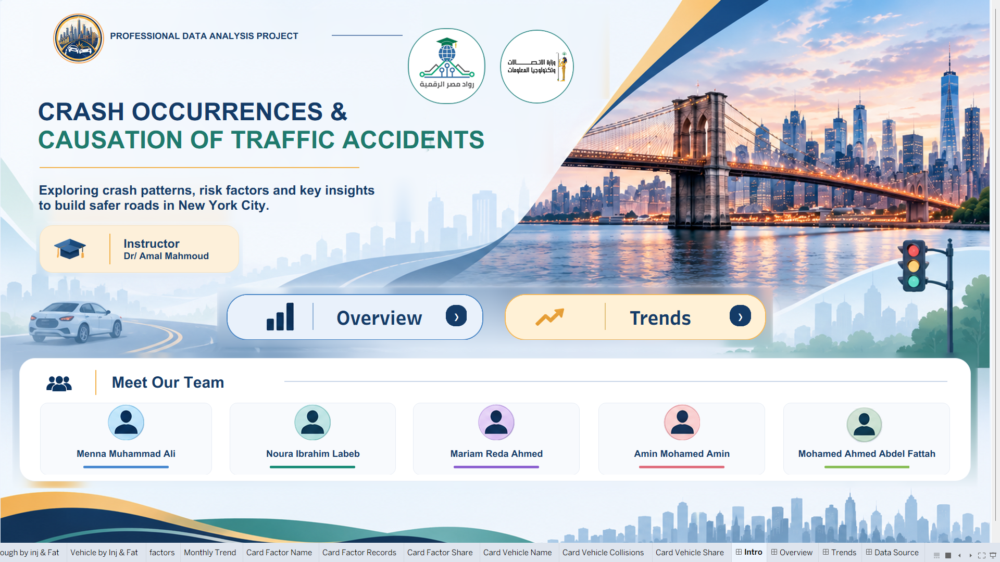
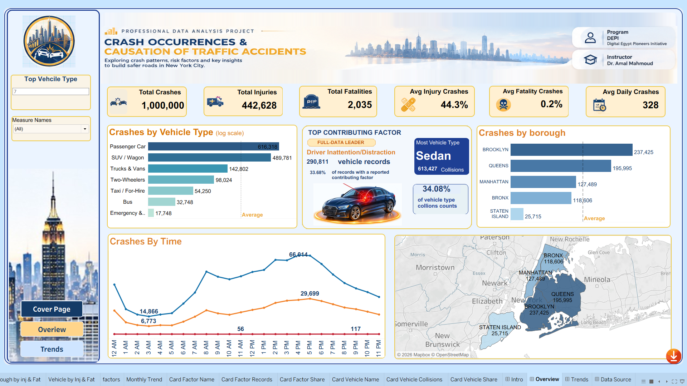
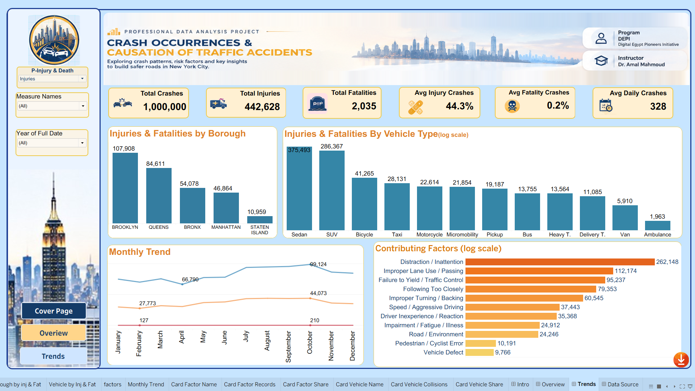

# Tableau Dashboard

📥 [Download the workbook (Final.twbx)](https://github.com/mohoka2006-a11y/Crash_Occurances_causation_Analysis/releases/tag/V1.0)

The workbook is hosted in Releases because of its size (~73 MB).

## Pages
- **Cover Page** project banner, team, and navigation
- **Overview:** KPIs, borough chart, map, hourly chart, Top-N vehicle types
- **Trends:** monthly trend, injuries/deaths by borough and vehicle type, factors

## Screenshots

## Notes
- Data covers 2018-07-04 → 2026-11-06.
